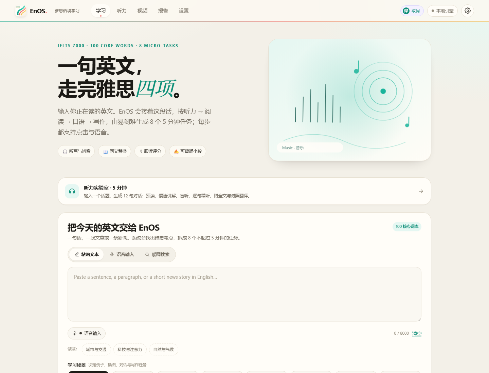
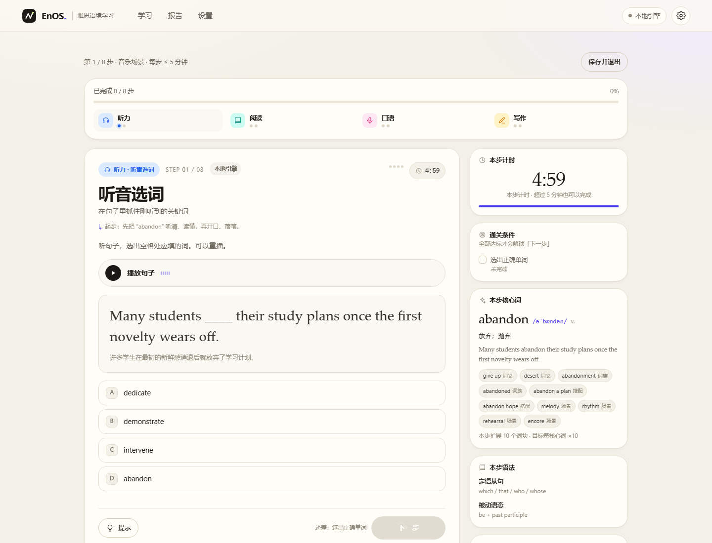
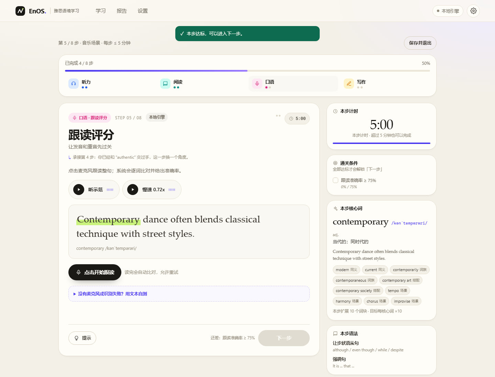
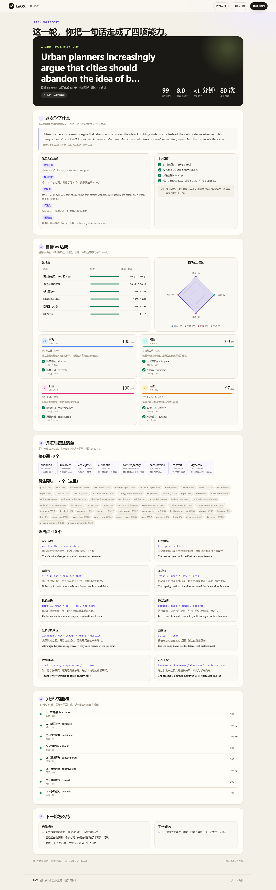

# EnOS · 雅思语境学习

> 一句英文，走完雅思四项。  
> 输入你正在读的英文，EnOS 按 **听力 → 阅读 → 口语 → 写作** 由易到难拆成 **8 个不超过 5 分钟**的微任务；每步支持点击与语音，通关后生成一份独立的学习报告。



---

## 目录

- [它解决什么问题](#它解决什么问题)
- [快速开始](#快速开始)
- [学习流程](#学习流程)
- [听力实验室](#听力实验室)
- [8 步任务与量化判定](#8-步任务与量化判定)
- [语音交互](#语音交互)
- [AI 与联网搜索](#ai-与联网搜索)
- [学习报告](#学习报告)
- [API Key 配置](#api-key-配置)
- [架构](#架构)
- [数据](#数据)
- [测试](#测试)
- [已知限制](#已知限制)
- [下一步可以做什么](#下一步可以做什么)
- [License](#license)

---

## 它解决什么问题

大多数人学雅思的方式是「背词表 + 刷题」，输入和输出是断开的：读到一段好文章，却不知道怎样把它变成听力辨音、口语表达和写作素材。

EnOS 把 **一段真实英文** 当作种子：

1. 先解析出其中的核心词、同义替换、语法结构与雅思考点；
2. 再按四个模块由易到难生成任务，每一步都能在 5 分钟内完成；
3. 用 **可量化的通关条件**（词汇接触量、语法点、正确率、写作 Band）决定是否可以进入下一步；
4. 最后输出一份包含原始输入、词汇清单、语法清单、四项进展与下一步建议的独立报告。

两个设计原则：

- **本地优先**：没有 API Key 也能完整走完 8 步并生成报告。AI 是增强项，不是前置条件。
- **每步都要动手**：选词、听写、跟读、对话、仿写、成段，全部需要真实操作才能通关，不能只点「下一步」。

---

## 快速开始

要求：Node.js **≥ 20.11**（使用内置 `fetch`、`node:test` 与 WebSocket）。

```bash
node -v
npm start
# 打开 http://127.0.0.1:8787
```

**零依赖**，不需要 `npm install`。可选环境变量：

| 变量 | 默认 | 说明 |
| --- | --- | --- |
| `PORT` | `8787` | 服务端口 |
| `HOST` | `127.0.0.1` | 绑定地址；只建议本机 |
| `DEEPSEEK_API_KEY` | – | 服务端 DeepSeek Key（无需在页面填写） |
| `MOONSHOT_API_KEY` | – | Kimi / Moonshot Key |
| `ZHIPU_API_KEY` | – | 智谱 Key |
| `MIMO_API_KEY` | – | 小米 MiMo Key |
| `CUSTOM_API_KEY` | – | 自定义 OpenAI 兼容服务 |
| `ENOS_DEMO_ONLY` | – | 设为 `1` 时健康检查显示 local-only（不阻止设置 Key） |

浏览器建议 Chrome / Edge（语音识别依赖 Web Speech API）。开发模式：

```bash
npm run dev     # node --watch
npm test        # 引擎 + 服务端测试
npm run smoke   # 真实浏览器端到端（需先 npm start，使用本机 Chrome）
```

---

## 学习流程

### 1. 输入

首页提供三种入口：

- **粘贴文本**：一句话、一段文章、一条新闻，最多 8000 字符。
- **语音输入**：说一段英文，自动转写；说 “search for urban gardening” 会直接触发联网检索。
- **联网搜索**：输入一个话题，检索并抓取排名靠前的网页正文，按句子边界截取 **150–220 词英文原文**；点击结果直接填入并开始学习。中文话题在配置 Key 后会先转成英文检索词。

选择 **场景**（音乐 / 漫画 / 体育 / 科普 / 旅行 / 美食 / 科技 / 自然）与 **目标 Band**。场景会影响示例句的改写、陪练角色、写作任务、对话设定与插图。

### 2. 解析

本地引擎会立刻给出：

- 命中的 100 核心词（不足 8 个时按场景与目标 Band 补足）；
- 同义替换对、学术词密度、最长句、语法结构、场景迁移建议；
- 8 个目标词与每个词的 10 个扩展词块（同义词、词族、搭配、场景词）。

### 3. 八步

页面顶部显示模块进度；每一步有倒计时（5:00）、通关条件、目标词卡、语法点与场景插画。完成判定实时更新，**只有全部达标才会点亮「下一步」**。每一步都会基于前一步已学的词生成衔接提示；AI 模式下，下一步会带着 `learnedWords` 重新改写。





### 4. 报告

第 8 步完成后跳转到独立页面 `/report.html?id=…`，可打印 / 存 PDF / 导出 JSON。

---

## 听力实验室

面向「听一句就卡住」的起步练习，独立于 8 步流程：打开顶部导航 **听力**（`#/listening`）。

1. **定话题**：文字输入，或点麦克风说一个话题（识别语言可切中文 / English）。
2. **生成对话**：配置 Key 时按话题生成 10–12 句双人对话；没有 Key 时使用本地通用模板，界面会明确标注「本地模板」。
3. **预读**：逐句看英文、中文；点「句子结构」按钮，句子会按主语 / 谓语 / 宾语 / 状语等成分拆成彩色下划线，每条线下面标出成分名。
4. **慢速讲解**：0.7× 逐句朗读，进入时自动展开当前句的成分图；详情区给出该句结构说明、语法点，以及关键词 / 词组 / 搭配的**英文语义、使用场景**和中文翻译。
5. **盲听**：0.95× 正常语速连播，默认隐藏文本；播完自动进入精听。
6. **精听回放**：点任意句子重听，支持 0.7×、显示中文、随机一句，并用句子圆点控制播放位置；每句都能单独开关结构标注。
7. **结果**：全文 + 逐句对照翻译，统计用时、听过句子、慢放 / 盲听 / 回放 / 语音指令次数，可复制或打印。

结构标注的约定（也用于 AI 生成）：

| 字段 | 含义 |
| --- | --- |
| `chunks[]` | 2–4 段连续原文，覆盖整句；每段有 `role`（主语 / 谓语 / 宾语 / 表语 / 定语 / 状语 / 补语 / 从句 / 连接词 / 意群） |
| `words[].term` | 关键词、词组或搭配（可以是多词） |
| `words[].zh` | 中文意思 |
| `words[].gloss` | 英文语义描述（≤ 14 词） |
| `words[].usage` | 英文使用场景 / 搭配说明（≤ 16 词） |

颜色：主语蓝、谓语绿、宾语琥珀、表语橙、定语粉、状语紫、补语青、从句靛、连接词灰。对齐由 `resolveChunks()` 完成：模型给的片段必须是原句的连续子串，找不到就退回逗号 / 分号切分的意群，绝不吞掉标点。

语音控制在慢速、盲听、精听阶段都可用；点麦克风后会先暂停音频，说完自动执行：

| 说 | 效果 |
| --- | --- |
| `播放` / `暂停` / `停止` | 控制当前音频 |
| `下一句` / `上一句` | 移动播放位置 |
| `第 4 句` / `第十一句` | 跳到指定句子 |
| `随机一句` | 随机跳到另一句（适合抽查） |
| `慢速` / `正常语速` | 切换 0.7× / 0.95× |
| `显示文本` / `隐藏文本` | 盲听时临时对照 |
| `生成结果` | 结束练习并生成全文与对照翻译 |

对话与结果都存在本机（`localStorage`），最近 8 份可随时回看。

---

## 8 步任务与量化判定

| # | 模块 | 任务 | 交互 | 通关条件 |
| --- | --- | --- | --- | --- |
| 1 | 听力 | 听音选词 | 点击 / 语音报选项 | 选出正确单词 |
| 2 | 听力 | 听写补全 | 输入 5 个缺失词 | 词级准确率 **≥ 80%** |
| 3 | 阅读 | 同义替换 | 四选一 | 选出正确替换词 |
| 4 | 阅读 | 判断题 | TRUE / FALSE / NOT GIVEN | 判断正确 |
| 5 | 口语 | 跟读评分 | 麦克风 / 文本自测 | 跟读准确率 **≥ 75%** |
| 6 | 口语 | 场景对话 | 语音或文字，2 轮 | 2 轮 + 用上目标词 + 累计 ≥ 15 词 |
| 7 | 写作 | 句型仿写 | 输入 2 句 | ≥ 20 词 + 目标词 + 目标句型 + ≥ 2 句 |
| 8 | 写作 | 小段成文 | 50–110 词 | 长度达标 + 目标词 + 2 个连接词 + **Band ≥ 6.0** |

**为什么是这个顺序**：听力只需要识别，阅读需要识别改写，口语需要带支撑地产出，写作需要独立、精确地产出。难度递增，同时遵循「输入 → 输出」的认知路径。

### 评分公式

每个 rubric 项都有自己的权重（默认 1）与达标线：

- `bool`：达成 1 / 未达成 0；
- `ratio`（准确率）：`min(实际/目标, 1)`；
- `count`：`min(实际/目标, 1)`；
- `range`（词数）：在区间内为 1，否则按比例衰减；
- `band`：`clamp((实际-4.5)/3.5, 0, 1)`。

单步得分：

```
stepScore = 100 × Σ(weightᵢ × ratioᵢ) / Σweightᵢ
completed = 所有 rubric 项均达标
```

整轮：

```
overall = 已完成步骤得分的平均值
bandEstimate = roundToHalf(4.5 + overall/100 × 3.5)   // 4.5 – 8.5
```

### 整轮量化目标

| 指标 | 目标 | 计算方式 |
| --- | --- | --- |
| 词汇接触量 | 8 核心词 × 10 = **80 次** | 每个词步的同义 / 词族 / 搭配 / 场景词块，含重复接触 |
| 去重词汇 | 报告展示 | 核心词 + 去重后的衍生词块 |
| 语法接触 | 2 点/步 × 8 = **16 次** | 每步 2 个语法点，含检测到的输入结构与新结构 |
| 听力正确率 | ≥ 80% | 选词 1/0 + 听写准确率 |
| 阅读正确率 | ≥ 80% | 同义替换 + 判断题 |
| 口语 | ≥ 75% | 跟读词级准确率 / 对话完成度 |
| 写作 | ≥ Band 6.0 | 本地 rubric，AI 模式下采用 AI 评分 |
| 单步时长 | ≤ 5 分钟 | 倒计时；超时不阻止完成，但会在报告中记录 |

时间只在页面可见时累计，避免切后台「刷时长」。

---

## 语音交互

使用浏览器原生 Web Speech API：

- **朗读**：`speechSynthesis`，可配置英式 / 美式 / 澳式语音与语速（设置页）。
- **识别**：`SpeechRecognition`（Chrome / Edge），英文任务用 `en-GB`，全局指令用 `zh-CN`。

每一步都可点击，也都可以说：

| 说 | 效果 |
| --- | --- |
| `play` / `播放` / `再听一遍` | 播放当前任务的示范音频 |
| `hint` / `提示` | 展开本步提示 |
| `A` / `B` / `C` / `D` / `选B` / `第二个` | 选择选项 |
| `next step` / `下一步` | 通关后进入下一步 |
| `stop` / `停止` | 停止朗读 |
| `report` / `报告` | 完成后生成报告 |

朗读时会显示波形动画；跟读步骤给出 **逐词命中 / 漏词高亮**、准确率、语速（词/分）与发音提示。没有麦克风时，所有跟读步骤都提供「用文本自测」的降级路径。

---

## AI 与联网搜索

### 支持的服务商

| 服务商 | 默认 Base URL | 默认模型 | 联网搜索 |
| --- | --- | --- | --- |
| DeepSeek | `https://api.deepseek.com/v1` | `deepseek-flash` | `POST /v1/tools/search` |
| Kimi / Moonshot | `https://api.moonshot.cn/v1` | `kimi-k3.1-pro` | `POST /v1/tools/search` |
| 智谱 GLM | `https://open.bigmodel.cn/api/paas/v4` | `glm-5.3-flash` | `POST /web_search` |
| 小米 MiMo | `https://api.xiaomimimo.com/v1` | `mimo-v2.6-flash` | 使用维基百科兜底 |
| 自定义 | 任意 OpenAI 兼容地址 | 自填 | 维基百科兜底 |

模型名与价格会变化，设置页可直接改 Base URL 与模型 ID，并提供「测试连接」。

### AI 用在哪

| 场景 | 调用 | 失败时 |
| --- | --- | --- |
| 单步场景改写 | 每步进入时 1 次 JSON 调用 | 保留本地版本，徽标显示「本地初稿」 |
| 陪练对话 | SSE 流式 `chat/completions` | 切换脚本化本地陪练 |
| 跟读反馈 | 通过后 1 次 JSON 调用 | 只显示本地逐词结果 |
| 写作评分 | 提交小段后 1 次 JSON 调用 | 保留本地 rubric 分数 |
| 报告叙事 | 报告页 1 次 JSON 调用 | 只显示本地规则建议 |
| 搜索整理（仅原文截取失败时） | 1 次调用 | 改用检索摘要拼接并标注「非原文」 |

AI 输出只做 **字段级校验后合并**：键名、类型、选项数量、`answerIndex` 范围、目标词是否出现，任何一项不合法就回退到本地内容。

### 搜索兜底顺序

1. 服务商原生搜索（DeepSeek / Kimi / 智谱）；
2. 维基百科 Search API；
3. DuckDuckGo HTML；
4. **抓取前 3 条结果的网页正文**，按句子边界截取 150–220 词英文原文（维基条目直接使用导语，不再额外请求）；
5. 全部抓取失败：有 Key 时让模型根据摘要整理并标注「非原文」，没有 Key 时用摘要拼接并明确提示；
6. 没有 Key 且检索本身失败时，返回清晰错误，提示直接粘贴文本。

抓取只读取 `http/https` 页面，拒绝内网地址，正文上限 1.5 MB、单页 9–12 秒超时；不做 OCR，也不执行页面脚本。

> 本仓库的自动化环境不允许 Node 进程访问外网，所以测试用本地 mock 服务覆盖了 chat / stream / search 全链路；真实联网需要在你有网络的机器上运行。

---

## 学习报告

独立页面：`/report.html?id=<sessionId>`。

包含：

- 原始输入、来源、场景、目标 Band；
- 雅思考点拆解（同义替换、学术词、长难句、语法、场景迁移）；
- 目标 vs 达成表（词汇、语法、听力、阅读、口语、写作）；
- 四项能力雷达图与模块卡（分数、正确率、每步证据）；
- 核心词卡 + 去重衍生词块 + 语法点清单；
- 8 步时间线（时长、得分、是否达标）；
- 优势 / 下一轮优先项；
- AI 教练总结（配置 Key 时）。

报告保存在浏览器 `localStorage`，最多 8 份；支持 `window.print()` 打印样式与 JSON 导出。



---

## API Key 配置

打开 **设置**：

1. 选择服务商；
2. 填入该服务商的 Key（每个服务商独立保存）；
3. 需要时修改 Base URL / 模型；
4. 点「测试连接」；
5. 关掉「AI 增强」即完全离线，不发出任何模型请求。

安全设计：

- Key 存在本机 `localStorage`，只随请求发送给 **本机 Node 服务**，由服务转发给厂商；
- 服务端不落盘、不写日志、不返回 Key；
- 也可用环境变量提供 Key，页面留空即可；
- API 请求校验 `Origin`，拒绝跨站调用；
- 响应带 CSP、`X-Content-Type-Options`、`X-Frame-Options`；
- 速率限制 240 次/分钟/IP，请求体上限 2 MB，上游超时 90s（流式 180s）。

> 这是本机单用户应用，没有账号系统。不要把服务直接暴露到公网。

---

## 架构

零依赖 Node 服务 + 原生 ES Module 前端，没有构建步骤。

```
en_os/
├─ server/
│  ├─ server.mjs        # 静态文件 + /api/chat + /api/search + 安全头
│  ├─ providers.mjs     # 服务商注册表、OpenAI 兼容 chat、错误归一化
│  ├─ search.mjs        # 三家原生搜索 + 维基/DDG 兜底 + 原文截取调度
│  └─ extract.mjs       # 网页正文抽取、句子边界截取、英文判定、抓取安全限制
├─ public/
│  ├─ index.html        # 学习 SPA
│  ├─ report.html       # 独立报告页
│  ├─ css/app.css
│  └─ js/
│     ├─ engine.js      # 解析、8 步生成、评分判定、报告汇总、AI 提示词
│     ├─ scoring.js     # 文本相似度、跟读比对、写作 rubric
│     ├─ scenes.js      # 8 个场景包
│     ├─ grammar.js     # 语法库与检测
│     ├─ dialogue.js    # 听力对话：提示词、字段校验、本地模板、结果文本
│     ├─ tasks.js       # 8 种任务渲染器（views/tasks.js）
│     ├─ session.js     # 学习状态机、计时、语音助手
│     ├─ home.js / settings.js / reports.js / listening.js
│     ├─ report.js      # 报告页渲染、雷达图、导出
│     ├─ api.js / store.js / speech.js / ui.js / art.js
│     └─ app.js         # hash 路由
├─ data/core100.json    # 100 个雅思核心词句
├─ tests/               # node:test（40 个测试）
├─ scripts/             # 校验、CDP 端到端、mock provider
└─ docs/
```

### 数据流

```
输入文本
  └─ analyzeInput() → 目标词 / 语法 / 考点 / 统计
       └─ createSession() → targets（80 词、16 语法、正确率阈值）
            └─ 第 n 步：
                 buildLocalStep() → 本地可完成的任务
                 + AI 改写（可选）→ applyAIStep() 字段级校验
                 → 用户操作 → evaluateStep() → 通关 / 得分
                 → 保存 results[n] → 进入第 n+1 步（带已学词上下文）
                      └─ summarizeSession() → 报告 + AI 叙事（可选）
```

会话状态全部在前端内存与 `localStorage` 中；服务端是无状态的（除了进程内限流计数），因此刷新页面、重启服务都不会丢学习记录（只要没清浏览器数据）。

听力实验室的数据流：

```
话题（文字 / 语音）
  └─ buildDialoguePrompt() → chat(JSON) → parseDialogue() 字段级校验
       └─ 校验失败或没有 Key → localDialogue() 本地模板
            └─ 预读 → 慢速讲解（0.7×）→ 盲听（0.95×）→ 精听回放
                 └─ 全文 + 逐句对照翻译（保存在 localStorage）
```

### 服务端接口

| 方法 | 路径 | 说明 |
| --- | --- | --- |
| GET | `/api/health` | 服务商列表、环境变量 Key 是否存在、版本 |
| POST | `/api/chat` | 转发 chat；支持 `stream: true` 的 SSE |
| POST | `/api/search` | 原生搜索 → 兜底 → 抓正文 → 英文原文截取 |
| POST | `/api/extract` | 抓取单个网页，返回句子边界对齐的英文原文 |
| GET | `/` `/report.html` `/data/core100.json` | 静态资源 |

---

## 数据

`data/core100.json` 每条包含：

```json
{
  "id": "abandon",
  "word": "abandon",
  "ipa": "/əˈbændən/",
  "pos": "v.",
  "zh": "放弃；抛弃",
  "def": "to give up something completely",
  "example": "Many students abandon their study plans once the first novelty wears off.",
  "exampleZh": "许多学生在最初的新鲜感消退后就放弃了学习计划。",
  "collocations": ["abandon a plan", "abandon hope"],
  "synonyms": ["give up", "desert"],
  "family": ["abandonment", "abandoned"],
  "scenes": ["science", "travel"],
  "band": 6.5
}
```

校验脚本：`npm run validate`（100 条、唯一 ID、例句包含目标词、字段完整、场景合法）。

语法库在 `public/js/grammar.js`，每条带正则检测器、句型框架、例句与中文提示；场景包在 `public/js/scenes.js`，包含设定、人物、道具、10 个主题词与写作/对话提示。

---

## 测试

```bash
npm test
```

- **40 个测试**：数据完整性、分析、8 步 payload 合法性、阈值判定、报告汇总、AI 覆盖校验、提示词、跟读比对、写作评分、语音指令、模块顺序、网页正文抽取与句子边界截取、听力对话校验 / 成分对齐 / 本地模板 / 结果文本、服务端 chat / 流式 / 搜索 / 原文抓取 / 安全。
- 服务端测试会自建 mock provider 与本地文章页，不依赖外网。

真实浏览器端到端：

```bash
npm start            # 终端 1
npm run smoke        # 终端 2：走完 8 步并截图到 .shots/
```

AI 路径（使用本地 mock）：

```bash
node scripts/mock-provider.mjs   # 终端 1
ENOS_AI=1 npm run smoke          # Windows PowerShell: $env:ENOS_AI='1'; npm run smoke
```

移动端：

```powershell
$env:ENOS_MOBILE='1'; npm run smoke
```

`.shots/` 里会生成首页、听力、口语、写作、报告与报告列表截图，`smoke.json` 记录控制台错误与页面异常。

---

## 已知限制

- **语音识别依赖浏览器与网络**：Chrome / Edge 的 Web Speech API 需要联网与麦克风权限；其他浏览器会退回文本自测。TTS 声音取决于操作系统。
- **没有音素级发音评分**：跟读评分是词级准确率 + 逐词高亮 + AI 语言反馈，不是发音学模型。
- **联网搜索可能被网络策略阻断**：代码提供服务商搜索 + 维基 + DDG 三层兜底，但企业网络/离线环境仍可能全部失败，此时会明确报错。
- **原文抓取受目标站点限制**：付费墙、反爬、纯前端渲染的页面可能拿不到正文；失败会回退到模型整理或摘要拼接，并在界面上标注「非原文」，不会冒充原文。
- **模型名称与接口会变化**：默认值按 2026-10 的官方文档填写，设置页可随时修改。
- **场景插画是程序化 SVG**：按场景与种子生成，可离线、无版权风险，但不是 AI 生成图片。
- **报告只存本机**，最多 8 份，没有账号与跨设备同步。
- **单步超时不会强制中断**：5 分钟是节奏目标，超时会计入报告，避免把学习者卡死在计时器上。
- **服务默认只绑定 127.0.0.1**，请勿直接暴露公网。

---

## 下一步可以做什么

- 接入真正的发音评估（音素 / 重音 / 语调）与录音回放；
- 选项化的 AI 绘图（如智谱 CogView），按词句生成配图；
- 间隔重复（SRS）复习队列，把报告里的词块排进第二天任务；
- 更多词表（雅思 7000 全量、托福、学术词表）与多篇输入的课程包；
- 账号体系与报告分享链接（服务端持久化）；
- 更严格的雅思评分器（四项 rubric 与官方描述对齐）。

---

## License

MIT。见 [LICENSE](LICENSE)。
