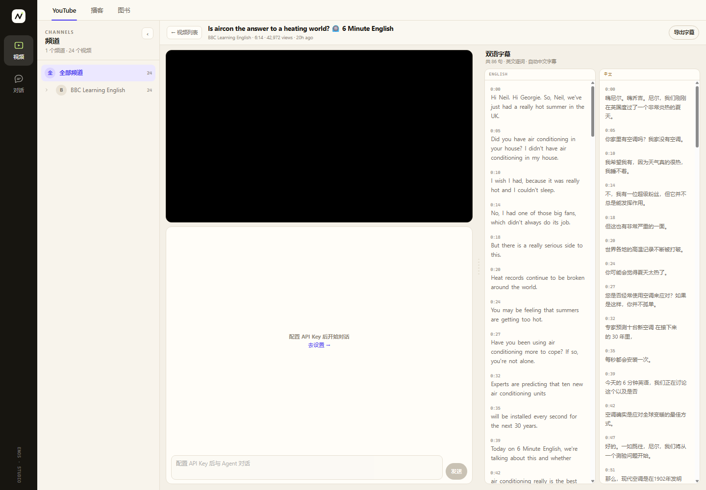
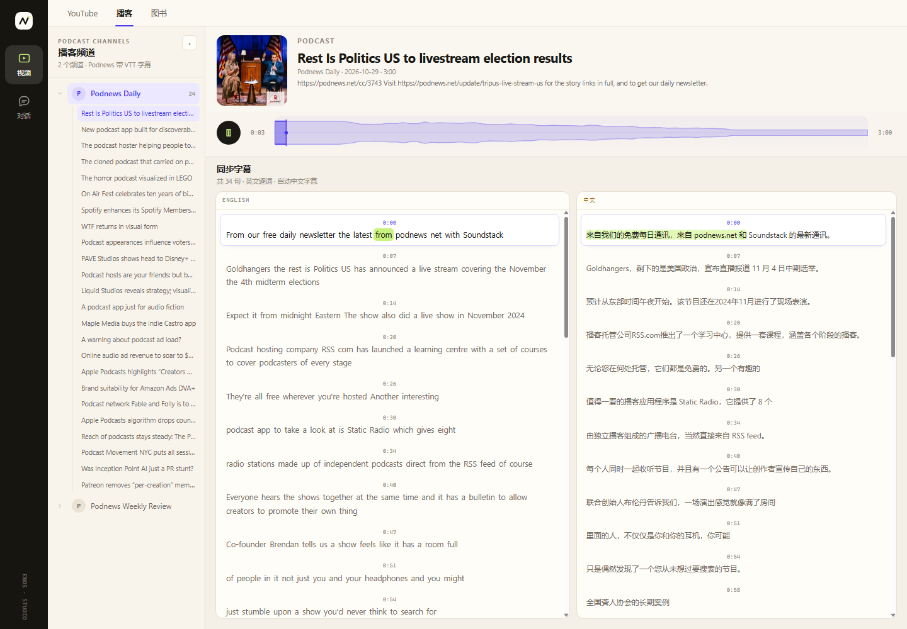
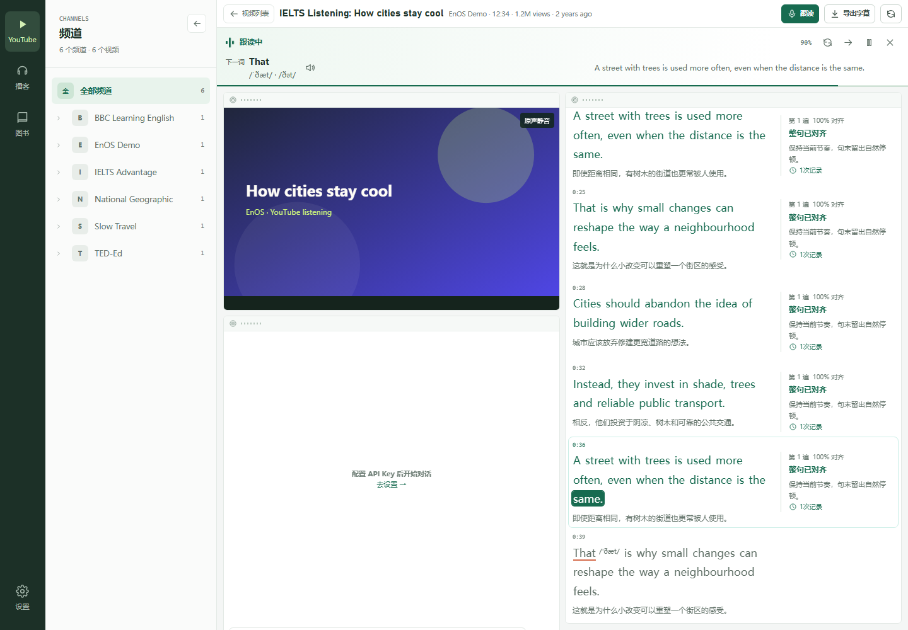
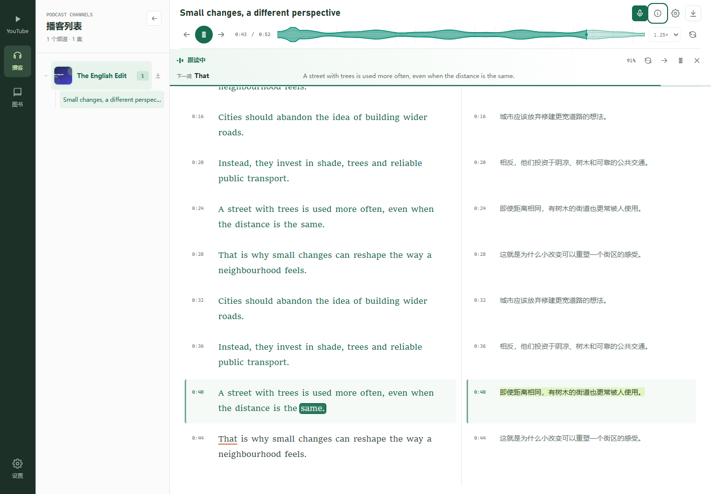
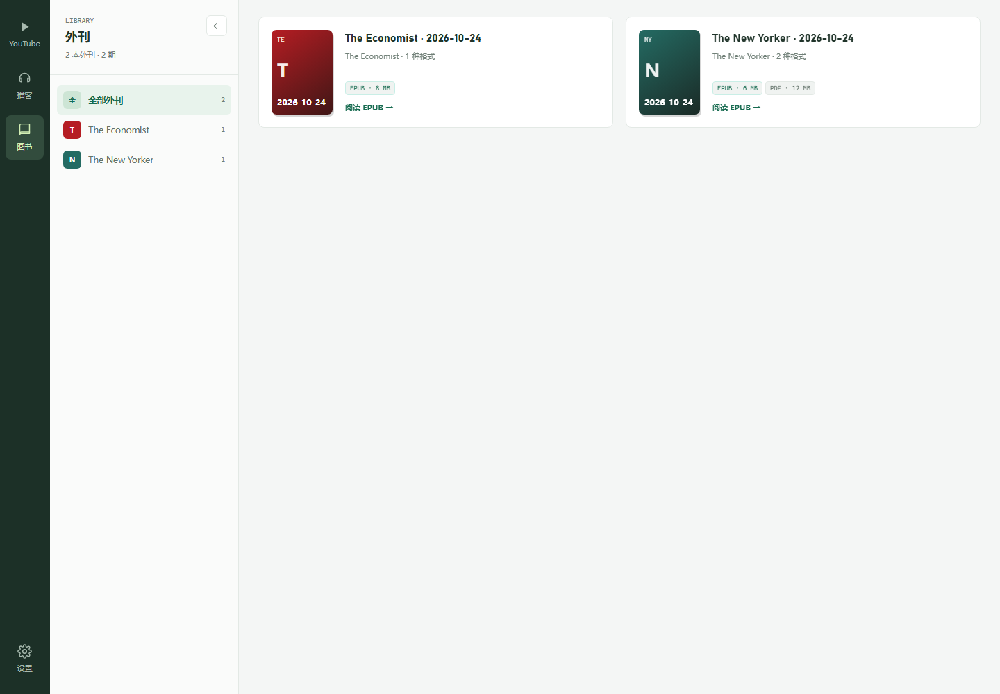

# EnOS

面向个人的英文内容学习工作台。左侧仅保留 **YouTube、播客、图书** 三个内容入口，设置位于底部。无需账号，打开后直接检索、播放或阅读。

前端使用原生 JavaScript ES Modules，后端使用 Node.js HTTP 服务，没有前端构建步骤。本项目需要联网，不是离线课程或考试评分系统。

## 快速开始

使用 **Node.js 24.5 或更新版本**、pnpm，以及现代 Chrome / Edge 浏览器。

```sh
pnpm install --frozen-lockfile
pnpm start
```

尚未安装 pnpm 时，可将命令中的 `pnpm` 替换为 `npx --yes pnpm@10`，无需全局安装。

打开 <http://127.0.0.1:8787>。默认只监听本机；不能通过直接打开 HTML 文件来使用服务端功能。

模型密钥不是播放和阅读的前置条件。没有 YouTube Data API Key 时会尝试网页检索；没有模型密钥时，字幕翻译会尝试 Google 免费接口。视频内问答需要模型密钥。

## 界面语言

所有页面默认使用简体中文，包括设置和未找到页面。点击左下方的语言图标，或在设置中的“界面语言”选择 **English**，即可即时切换英文；选择“中文”切回。不需要刷新，也不会重建播放器、停止正在运行的跟读、清空对话草稿或重置当前阅读章节。

语言偏好与其他设置一起保存在本机，刷新或再次打开页面后仍然生效。旧配置和不支持的语言值回到中文；恢复默认设置或清空本机数据也会恢复中文。

翻译范围是导航、控件、提示、错误和跟读点评等界面文字。视频和播客字幕、内容标题、书籍正文、用户问题与 Agent 回答保留原文；切换界面语言不会改写学习内容，也不会改变 `en-US` 语音识别语言。

国际化使用本机分发的 i18next，无需额外远程翻译请求。词条位于 [public/js/locales/en.js](public/js/locales/en.js)；动态消息通过参数绑定更新，原始内容使用 `translate="no"` 或原文参数，避免与界面词条重名时被翻译。

## 全屏

左下方、设置按钮上方的全屏图标适用于 YouTube、播客、图书目录和阅读页面。点击进入，再次点击退出；也可使用浏览器的 Esc 退出。图标和提示随浏览器实际全屏状态更新。

全屏保留频道导航、字幕、Agent 和阅读控件，不重新加载媒体，播放进度、对话草稿、视频窗口排列和当前章节保持不变。不支持页面全屏的浏览器会禁用入口并显示原因。

## YouTube

- 关键词检索、按频道筛选，显示视频预览、时长和字幕状态。
- 播放器、Agent、英文字幕、中文字幕是四个可拖放窗口。多列水平平铺并从同一上边界开始，列内自上而下紧凑排列；桌面同列底部窗口补齐剩余高度。
- 缩放任一窗口的左右边缘会实时调整整列宽度，由相邻列补偿空间。同列上下拖动只改顺序、不改宽度；跨列拖动自动采用目标列的宽度。
- 位置、尺寸和窗口显隐自动保存在本机；桌面与手机坐标分别保存，标题栏的恢复布局按钮可回到默认排列并显示全部窗口。
- 顶部布局图标展开格子缩略图菜单，反映当前窗口分布。勾选或取消可分别显示、隐藏四个窗口，全部隐藏后也可从同一菜单恢复。
- 英文逐词高亮、中文逐字进度，点击句子或单词跳转。
- 优先使用可用的中文字幕，缺失时分批翻译；可导出带时间标记的双语 Markdown。
- 视频内的 Agent 使用视频与字幕上下文回答问题，不提供独立通用对话页。



拖动各窗口上方的手柄移动；手机需先长按手柄再拖动，在单列中调整顺序和高度，窗口内容仍可独立滚动。聚焦手柄后，上下方向键在同列换位，桌面左右方向键移到相邻列，`Shift` + 方向键调整列宽或窗口高度。调整布局或隐藏窗口不会重建视频播放器或清空对话草稿；隐藏整列会让其余列铺满，重新显示仍保留原列归属。只保存窗口标识、坐标和显隐偏好，不保存窗口 HTML 或媒体内容。菜单中的缩略图随拖放、缩放和显隐变化更新；按 Esc 关闭并返回布局入口。

不是每个视频都有字幕、可嵌入或可在当前地区播放。人工字幕缺少词级时间时，高亮是句内估算；字幕提取也可能受 YouTube 的验证和接口变化影响。

## 播客

内置两个提供 WebVTT 字幕的公开频道：

| 频道 | RSS |
| --- | --- |
| Podnews Daily | <https://podnews.net/rss> |
| Podnews Weekly Review | <https://feeds.buzzsprout.com/1538779.rss> |

- 浏览频道与单集，播放、暂停、跳句、重听当前句及 0.75–2 倍速。
- 动态波形支持定位；字幕按音频时钟更新，并保留源字幕中的停顿和词级时间戳。
- 桌面使用左右双语字幕，手机使用逐句双语排列。
- 标题栏提供单集详情、跟随播放设置、字幕校准和双语 SRT 下载。
- 校准范围为 -3 至 3 秒，正值延后字幕、负值提前字幕，按单集保存在浏览器。



音频通过同源代理流式传输，支持单段 Range 请求。动态广告、片头差异或蓝牙延迟仍可能需要手动校准；只有句级时间的字幕无法还原真实逐词发音边界。

## 语音跟读

YouTube 和播客播放器的标题栏都提供麦克风入口。字幕准备好后点击开启，从当前词开始练习，不需要模型 API Key。

- **由朗读推进**：英文高亮与字幕位置随识别结果更新；读得快慢会影响静音视频的推进，停下来时画面与字幕等待，不按原视频速度自动往前走。
- **原声静音**：视频仅显示画面；播客音频保持暂停，时间轴随朗读定位，避免原声干扰识别。
- **保持当前位置可见**：自动定位当前词，包括长句中后半部分。跟读时中文以小字体放在英文下一行，当前句右侧显示点评；手机暂时收起 Agent，保留视频和字幕同屏。
- **下一词音标与发音**：标记下一词，在控制条中显示美式 IPA 音标，多种词典读音同时列出；字幕单词后不追加音标，避免音标切换造成整句重新排版。点击控制条中的喇叭播放英语示例，再次点击可停止。播放前等待麦克风释放，结束后只恢复此前开启的识别，不会让示例推动字幕或生成点评，原视频和播客始终静音。
- **逐句、逐遍点评**：显示识别对齐情况，指出未对齐的词并给出简短调整建议。尚未读到的词不会提前判为遗漏；缩写和数字需要完整对齐才计为一个词。重读生成新记录，点击句旁的时钟可查看每一遍的点评，跳句或退出也保留已经练习的部分。
- **随时调整**：点击字幕或单词重新定位，重读当前句、跳到下一句，或暂停麦克风后继续。控制条显示识别文字、下一词、当前练习段进度和估算练习速度。
- **退出恢复**：结束跟读恢复此前的静音、倍速和播放状态，以及 YouTube 的四窗排列。跟读使用临时布局，不覆盖普通播放模式保存的位置。切换内容、离开页面、完成当前段时关闭识别；切到后台会暂停麦克风，返回后需手动继续。





使用支持 `SpeechRecognition` / `webkitSpeechRecognition` 的浏览器，推荐 Chrome / Edge，并允许麦克风权限。必须通过本机 `localhost` / `127.0.0.1` 或 HTTPS 访问；不支持的浏览器会禁用入口。

识别默认使用英语 `en-US`。本应用不录制、保存或上传麦克风音频，识别文字只保留在当前练习内；**浏览器自身的识别服务可能把音频发送到其服务器**，是否联网、可用地区与隐私政策由浏览器决定。服务端代理不会自动代理这条浏览器识别链路。

点评记录按媒体保存在本机，保留最近 16 个媒体、每个媒体最多 1000 条记录、每句最近 20 遍。只保存字幕关联、对齐词索引及点评所需元数据，不保存识别原文；重新进入同一内容可以恢复，英文字幕变化时不沿用不对应的记录。在设置中清空本机数据可删除点评。

音标使用随项目分发的约 12.6 万词美式词表，在服务端本地查询，不需要额外 API Key 或外部词典连接；来源和原始许可见 [音标数据说明](docs/PRONUNCIATION_DATA.md)。未收录的词显示“音标暂缺”，不猜测音标。发音示例由浏览器/系统的 `SpeechSynthesis` 生成，优先选择美式英语语音；声音、语言包和是否联网取决于设备。英语语音不可用时会提示，不影响继续跟读。

点评依据字幕文字与识别结果的对齐情况，**不是音素、发音或口音评分**。“未对齐”可能来自漏读或识别误差，不直接断言发音错误；对齐比例从本次选择的起点计算。原生识别有延迟，缩写、数字和附近漏词会尝试对齐，但误识别仍可能让进度停住；可重读或点击目标词重新定位。网络错误会保留静音和进度，允许重连；权限拒绝则退出跟读并恢复音频设置，不自动播放原声。

## 图书

目录来自 [hehonghui/awesome-english-ebooks](https://github.com/hehonghui/awesome-english-ebooks)，目前按 The Economist、The New Yorker、The Atlantic、Wired 四类组织，期数以实时目录为准。

- 按杂志筛选和浏览期刊。
- 有 EPUB 的条目可在工作台内阅读，支持章节目录、上一章和下一章。
- 按源仓库实际提供的格式下载 EPUB、PDF 或 MOBI；PDF / MOBI 不提供在线解析。
- 服务端按需下载 EPUB，提取纯文本章节，不把外部 HTML 或脚本直接嵌入页面。



目录和解析结果使用有期限、有数量上限的服务端内存缓存，重启后失效。首次阅读大文件可能较慢；GitHub 限流、源文件删除、加密或不兼容 EPUB 都可能导致无法打开。

以上截图来自浏览器回归中的固定样例，不代表线上库存或字幕服务的实时可用性。媒体版权属于各自权利人；本项目不打包外刊文件，请确认访问、阅读和下载符合内容授权及当地法律。

## 设置与密钥

底部设置入口可调整界面语言、模型服务商、API Key、Base URL、模型名称和 YouTube 搜索 Key，并提供连接测试、恢复默认和清空本机数据。恢复默认时保留已经保存的密钥。

支持 DeepSeek、Kimi / Moonshot、智谱、MiMo 及兼容 OpenAI `/chat/completions` 的自定义服务。默认模型与候选模型不保证适用于每个账号，以服务商实际开放为准。

也可以在启动前设置环境变量，避免把密钥保存到浏览器：

| 服务商 | 密钥变量 | 可选服务端地址变量 |
| --- | --- | --- |
| DeepSeek | `DEEPSEEK_API_KEY` | `DEEPSEEK_BASE_URL` |
| Kimi | `MOONSHOT_API_KEY` | `MOONSHOT_BASE_URL` |
| 智谱 | `ZHIPU_API_KEY` | `ZHIPU_BASE_URL` |
| MiMo | `MIMO_API_KEY` | `MIMO_BASE_URL` |
| 自定义 | `CUSTOM_API_KEY` | `CUSTOM_BASE_URL` |

环境密钥只能用于对应服务端配置的 Base URL。若使用代理网关，应同时配置该服务商的地址变量；仅在页面更改地址不能转发环境密钥。显式填写的浏览器密钥会发送至所选地址，因此只应使用可信服务。

Base URL 必须使用 HTTPS，本地 `localhost`、`127.0.0.1` 和 `::1` 调试服务允许 HTTP；地址不得含用户名、密码、查询参数或片段。模型请求不跟随重定向。

| 其他变量 | 默认值 | 用途 |
| --- | --- | --- |
| `PORT` | `8787` | 本机服务端口 |
| `HOST` | `127.0.0.1` | 监听地址，建议保持默认 |
| `YOUTUBE_API_KEY` | 未设置 | YouTube Data API v3 搜索密钥 |
| `YOUTUBE_COOKIE` | 未设置 | 可选 YouTube 请求 Cookie，属于敏感信息 |
| `YOUTUBE_PROXY` | 未设置 | Node 出站 HTTP(S) 代理 |
| `HTTPS_PROXY` / `HTTP_PROXY` | 未设置 | 通用出站代理 |
| `NO_PROXY` | 本机地址 | 不走代理的地址，已有设置会保留 |

PowerShell 代理示例：

```powershell
$env:YOUTUBE_PROXY = 'http://127.0.0.1:13480'
pnpm start
```

也可以在根目录创建已被 Git 忽略的 `proxy.config.json`：

```json
{ "proxy": "http://127.0.0.1:13480" }
```

启动器会启用 Node 的 `NODE_USE_ENV_PROXY`。代理作用于服务端出站请求，不会替浏览器的 YouTube iframe、视频或封面设置代理；浏览器仍须能访问相关站点。

## 隐私与安全边界

- 浏览器配置保存在此站点的 `localStorage`，密钥是明文，不应保存在共享设备。清空本机数据不会删除服务端环境变量。
- 模型翻译与问答会把字幕上下文和问题发送到所选模型服务商，可能产生费用。关闭模型开关不等于离线：免费翻译仍可能把字幕发送给 Google。
- YouTube 播放器会直接连接 Google；服务端还会按功能访问 YouTube、Google 翻译、播客发布方和 GitHub。请勿输入不应外发的敏感内容。
- 服务没有账号或远程访问鉴权。Host / 来源校验、限流与 CSP 只是纵深防护，不能替代鉴权；不要直接暴露到公网或不可信局域网。
- JSON 请求只接受对象，最大 2 MiB；静态文件限制在 `public/` 内，并检查真实路径。
- 播客资源及每次重定向均校验受信域名；RSS / VTT 最大 4 MiB。增加新发布方时需同步审查域名和 CSP。
- EPUB 下载最大 64 MiB，单条目解压最大 8 MiB，声明的总展开大小最大 128 MiB，目录最多 4096 条；超限文件拒绝解析。

## 开发与验证

```sh
pnpm dev
pnpm check
pnpm test
pnpm smoke
pnpm smoke:mobile
node scripts/video-check.mjs --layout
node scripts/video-check.mjs --layout --mobile
```

`dev` 使用 Node watch 模式并沿用代理启动配置。`check` 解析保留模块并检查相对依赖和工作台资源，不执行应用；Node 的 VM Modules 实验性提示是预期输出。

单元与服务端测试不依赖真实模型或公开视频。浏览器回归需先启动服务、安装本机 Chrome / Edge，并使用 Node.js 24+；可用 `CHROME_PATH` 指定浏览器、`ENOS_URL` 指定工作台地址。

浏览器回归使用固定视频、音频、图书及模拟识别/语音合成事件，实际调用本地音标接口和浏览器全屏 API，验证三类内容全屏进出与状态保留、侧栏、设置、四窗鼠标/触摸拖放与缩放、同列换位不变宽、跨列继承宽度、松开鼠标前的整列同步、水平铺满与纵向紧凑排列、显隐和重新初始化恢复、字幕同步、波形、下载、跟读静音/语速/滚动、发音与识别隔离、逐遍点评和历史恢复，以及手机/320px 字幕布局。`--layout` 只运行窗口布局回归。双语检查覆盖全部视图、动态错误、语言存储、404、原文保护和切换时的媒体状态保留。不验证实际人声识别准确率、扬声器听感或第三方服务始终可用。截图及检查结果输出到被忽略的 `.shots/`。

### 更新与缓存

- `public/` 下的 HTML / CSS / JS 由服务器直接读取，改完普通刷新即可；服务端 `server/*.mjs` 改动必须重启服务。
- HTML / CSS / JS 现在返回 `Cache-Control: no-store`，浏览器不会拿旧模块继续运行；如果当前标签页仍显示旧界面，按 **Ctrl + F5** 或关闭旧标签页重新打开。
- 旧 `/watch.html` 已停用并返回 **404**，不要再从收藏夹打开旧播放页；视频详情现在在 `/videos.html` 内。
- 工作台会把频道栏折叠状态和四窗布局存入 `localStorage`，刷新会保留；要恢复默认布局，打开一次：

  ```text
  /videos.html?reset=1
  ```

  该参数会清除频道栏、四窗布局和显隐偏好，然后自动从地址栏移除。
- 项目当前没有 `npm restart` 脚本；停止旧进程后执行 `npm start` 即可（本会话中由代理执行等价的停止 + 启动）。

图标资源保存在 `public/`。`pnpm icons` 使用本机浏览器从 `icon-mark.png` 重新生成 SVG、PNG 和多尺寸 ICO，保留左上 K 与右下原始曲线的组合。

## 目录结构

```text
public/
  videos.html          工作台唯一应用入口
  404.html             未找到页面
  css/                 基础控件与媒体布局
  js/                  API、设置、字幕同步、语音跟读、发音示例和工作台控制器
server/                HTTP、模型、YouTube、播客、图书、词级时间与离线音标
  ipa-en-us.txt        随项目分发的美式 IPA 词表
scripts/               模块检查、浏览器回归与图标生成
tests/                 当前功能及安全边界回归
docs/screenshots/      当前三类内容的示例截图
```

代码按 [MIT License](LICENSE) 分发；窗口布局使用本机分发的 GridStack，许可见 [GridStack License](docs/GRIDSTACK_LICENSE.txt)；国际化使用 i18next，许可见 [i18next License](docs/I18NEXT_LICENSE.txt)。第三方内容与资源遵循各自的授权，音标词表的许可与来源见 [数据说明](docs/PRONUNCIATION_DATA.md)。